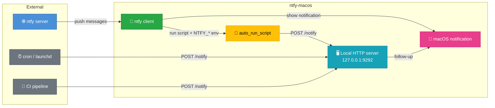

# ntfy-macos

[](https://github.com/dylancetin/ntfy-macos/actions/workflows/build.yml)
[](https://buymeacoffee.com/laurentftech)
[](LICENSE)
[](https://www.apple.com/macos/)
[](https://swift.org/)

**Security-hardened fork of [laurentftech/ntfy-macos](https://github.com/laurentftech/ntfy-macos).**
See [Mac build / local-agent instructions](docs/BUILD_ON_MAC.md) and the
[security changes and migration guide](docs/SECURITY_HARDENING.md).

Receive push notifications on your Mac from any source — servers, IoT devices, home automation, CI pipelines, or custom scripts. No account required, works with the public [ntfy.sh](https://ntfy.sh) service or your own self-hosted server.

**ntfy-macos** is a native macOS client that subscribes to ntfy topics and delivers rich notifications with SF Symbols, images, and interactive buttons. Trigger shell scripts automatically when messages arrive.


## Features

- **Native macOS Notifications**: Rich notifications with SF Symbols and local images
- **Multi-Server Support**: Connect to multiple ntfy servers simultaneously
- **Emoji Tags**: Automatic conversion of ntfy tags to emojis in notification titles
- **Interactive Actions**: Add custom buttons to notifications that execute scripts or open URLs
- **Automatic Script Execution**: Run shell scripts automatically when messages arrive
- **Silent Notifications**: Receive messages without displaying notification banners
- **Secure Authentication**: Store tokens securely in macOS Keychain
- **Robust Reconnection**: Handles network interruptions and sleep/wake gracefully
- **Priority Mapping**: Maps ntfy priority levels to macOS interruption levels (critical, time-sensitive)
- **Menu Bar App**: Runs in the menu bar with quick access to config and reload
- **Live Config Reload**: Configuration changes are detected and applied automatically
- **Config Validation**: Warns about unknown keys and typos in the menu bar
- **Click to Open**: Click notifications to open in browser (configurable per topic)
- **Automatic Permission Request**: Prompts for notification permission on first launch
- **Local Notification Server**: Built-in HTTP server on localhost for scripts to trigger notifications
- **Settings Window**: Native SwiftUI interface for server and topic configuration with real-time connection status

## Installation

The original author's Homebrew tap installs the upstream version, **not this fork's fixes**.
Build this fork from source using the steps below or the detailed [Mac handoff](docs/BUILD_ON_MAC.md).

### Build from Source

```bash
# Clone the repository
git clone https://github.com/dylancetin/ntfy-macos.git
cd ntfy-macos

# Test and build using the pinned dependency
swift test --force-resolved-versions
./build-app.sh

# Install for the current user
mkdir -p "$HOME/Applications"
ditto .build/release/ntfy-macos.app "$HOME/Applications/ntfy-macos.app"
```

### Updating

```bash
# In this fork's checkout, after stopping the running app:
git pull --ff-only
swift test --force-resolved-versions
./build-app.sh
ditto .build/release/ntfy-macos.app "$HOME/Applications/ntfy-macos.app"
```

**Note**: Use Xcode with Swift 6 or newer. See the build guide for toolchain selection and signing details.

## Quick Start

1. **Initialize Configuration**

```bash
ntfy-macos init
```

This creates a private sample configuration at `~/.config/ntfy-macos/config.yml` without overwriting an existing file.
Use the binary at `$HOME/Applications/ntfy-macos.app/Contents/MacOS/ntfy-macos`, or add its directory to your PATH.

2. **Edit Configuration**

Edit the configuration file to add your servers and topics:

```yaml
servers:
  - url: https://ntfy.sh
    topics:
      - name: alerts
        icon_symbol: bell.fill

  - url: https://your-private-server.com
    token: tk_yourtoken
    topics:
      - name: deployments
        icon_symbol: arrow.up.circle.fill
        auto_run_script: ~/scripts/deploy-handler.sh
```

3. **(Optional) Store Authentication Token in Keychain**

```bash
ntfy-macos auth add https://ntfy.sh tk_yourtoken
```

4. **Start the Service**

```bash
# Run the patched binary directly (stop an older Homebrew service first if applicable)
ntfy-macos serve
```

On first launch, the app will automatically request notification permission.

The app runs in the menu bar with options to:
- **Server Status**: Shows connection state for each server (green=connected, red=disconnected, orange flashing=connecting)
- **Settings**: Open the Settings window to configure servers, topics, and local server (⌘,)
- **Show Config in Finder**: Reveal config directory
- **Reload Config**: Apply configuration changes (⌘R)
- **View Logs**: Open log files (with automatic rotation) (⌘L)
- **About**: Credits and links
- **Quit**: Stop the service

5. **(Optional) Add to Launchpad**

```bash
open "$HOME/Applications/ntfy-macos.app"
```

## Configuration

The configuration file is located at `~/.config/ntfy-macos/config.yml`.

For a complete list of all configuration options and detailed examples, please see the [config-examples.yml](examples/config-examples.yml) file.

### Basic Structure

```yaml
servers:
  - url: https://ntfy.sh
    topics:
      - name: alerts
        icon_symbol: bell.fill
        actions:
          - title: Open Dashboard
            type: view
            url: "https://dashboard.example.com"

  - url: https://your-private-server.com
    token: tk_yourtoken
    topics:
      - name: deployments
        icon_symbol: arrow.up.circle.fill
        auto_run_script: ~/scripts/deploy-handler.sh
```

### Configuration Options

#### Global Fields

- `local_server_port` (optional): Port 1024–65535 for the authenticated local notification HTTP server. Disabled if omitted.
- `local_server_token` (required when the local server is enabled): A private bearer token of 32–256 ASCII letters, digits, `_` or `-`. Generate one with `openssl rand -hex 32`, or enable the port and Save in Settings to generate it automatically.

#### Server Fields

- `url` (required): Server URL
- `token` (optional): Authentication token
- `topics` (required): List of topics
- `allowed_schemes` (optional): Allowed URL schemes; defaults to HTTP/HTTPS. Prefer `[https]`.
- `allowed_domains` (optional): Allowed destination hosts, with optional `*.example.com` patterns. HTTP action buttons require an explicit nonempty allowlist; `[]` denies all destinations. Browser-opening actions retain the upstream unrestricted-domain default when omitted.

#### Topic Fields

- `name` (required): Topic name
- `icon_symbol` (optional): SF Symbol name
- `icon_path` (optional): Path to a local image file
- `auto_run_script` (optional): Script to execute on every message
- `silent` (optional): If `true`, skip notification banner
- `click_url` (optional): Custom URL to open on click
- `actions` (optional): List of interactive buttons

#### Action Fields

- `title` (required): Button label
- `type` (required): `script`, `view`, `shortcut`, or `applescript`
- `path` (for `script` and `applescript` file): Absolute path to the script file
- `url` (for `view`): URL to open
- `name` (for `shortcut`): macOS Shortcut name
- `script` (for `applescript` inline): AppleScript source code

**Note**: Config-defined actions ALWAYS override any actions sent with the ntfy message.

Here’s a summary of how actions are handled:

| Action type | ntfy protocol | ntfy-macos (payload)    | ntfy-macos (config.yml)     |
| ----------- | ------------- | ----------------------- | --------------------------- |
| view        | ✅ Standard    | ✅ Supported             | ✅ Supported                 |
| http        | ✅ Standard    | ✅ Supported             | ❌ Not supported (by design) |
| broadcast   | ✅ Standard    | ❌ Ignored (Android-only)| ❌ Not applicable            |
| script      | ❌             | ❌ Blocked               | ✅ Supported                 |
| applescript | ❌             | ❌ Blocked               | ✅ Supported                 |
| shortcut    | ❌             | ❌ Blocked               | ✅ Supported                 |

> `script`, `applescript`, and `shortcut` commands are **only selected from local config.yml**. Publishers can still trigger configured automation and supply its input, so scripts must handle that input as untrusted data. HTTP actions enforce destination policies and reject redirects.

**Note:** `applescript` and `shortcut` are **ntfy-macos client-specific action types**. Only `view`, `http`, `broadcast`, and `dismiss` are part of the official ntfy protocol.

## CLI Commands

### serve

Start the notification service:

```bash
ntfy-macos serve
```

### auth

Manage authentication tokens in Keychain:

```bash
# Add a token
ntfy-macos auth add <server-url> <token>

# List all stored tokens
ntfy-macos auth list

# Remove a token
ntfy-macos auth remove <server-url>
```

Keychain tokens take priority over tokens in the YAML configuration.

### test-notify

Send a test notification (and request permissions):

```bash
ntfy-macos test-notify --topic <NAME>
```

### init

Create a sample configuration file:

```bash
ntfy-macos init
```

### help

Display help information:

```bash
ntfy-macos help
```

## Script Execution

Scripts receive the message body as the first argument (`$1`) and full message context as environment variables:

```bash
#!/bin/bash
MESSAGE="$1"

# Environment variables available:
# NTFY_ID       - Unique message ID
# NTFY_TOPIC    - Topic name
# NTFY_TIME     - Unix timestamp
# NTFY_EVENT    - Event type (always "message")
# NTFY_TITLE    - Message title (if set)
# NTFY_MESSAGE  - Message body (if set)
# NTFY_PRIORITY - Priority level 1-5 (if set)
# NTFY_TAGS     - Comma-separated tags (if set)
# NTFY_CLICK    - Click URL (if set)

echo "[$NTFY_TOPIC] $NTFY_TITLE: $MESSAGE"
# Your automation logic here
```

### Environment

Scripts are executed with an enhanced PATH:
```
/opt/homebrew/bin:/usr/local/bin:/usr/bin:/bin:/usr/sbin:/sbin
```

This ensures Homebrew-installed tools are available.

### Make Scripts Executable

```bash
chmod +x /path/to/your/script.sh
```

### Security Considerations

Scripts are **only selected from your local `config.yml`**, scoped to the originating server and subscribed topic. Configured scripts run with your privileges and can still misuse untrusted message text. The application does not provide an OS sandbox for those scripts.

**Best practices:**
- Only configure scripts that you trust and have reviewed
- Use absolute paths to scripts
- For public topics, avoid `auto_run_script`
- Keep your configuration file secure (`chmod 600 ~/.config/ntfy-macos/config.yml`)
- For sensitive automation, use a self-hosted ntfy server with authentication
- Use `allowed_schemes` and `allowed_domains` to restrict which URLs can be opened.

## Local Notification Server

ntfy-macos can run a local HTTP server on localhost that allows scripts and local tools to trigger macOS notifications directly, without going through an external ntfy server.



### Setup

Generate a token with `openssl rand -hex 32`. Add the port and generated token to your private `config.yml`, or enable the port and Save in Settings:

```yaml
local_server_port: 9292
local_server_token: ... # replace with the generated token; this placeholder is intentionally invalid

servers:
  - url: https://ntfy.sh
    topics:
      - name: alerts
```

### Usage

Set `NTFY_LOCAL_TOKEN` in your local script environment to the configured token (do not publish it). Send an authenticated JSON POST, or copy the ready-to-use command from Settings after saving:

```bash
curl -X POST http://127.0.0.1:9292/notify \
  -H "Authorization: Bearer $NTFY_LOCAL_TOKEN" \
  -H "Content-Type: application/json" \
  -d '{"title": "Build Complete", "message": "Project compiled successfully", "priority": 3, "tags": ["white_check_mark"]}'
```

### API

**POST /notify**

| Field      | Type     | Required | Description                              |
|------------|----------|----------|------------------------------------------|
| `title`    | string   | Yes      | Notification title                       |
| `message`  | string   | Yes      | Notification body                        |
| `priority` | integer  | No       | Priority 1-5 (maps to macOS levels)      |
| `tags`     | string[] | No       | Emoji tags (e.g., `["warning", "fire"]`) |

**GET /health** - Returns `{"status": "ok"}` for authenticated health checks. Both endpoints require the bearer token. Browser-origin requests are rejected.

### Example: Auto-run Script with Local Notifications

Combine `auto_run_script` with the local server to create rich feedback loops:

```bash
#!/bin/bash
# auto_run_script for topic "deployments"
# Receives message via $1 and env vars, then triggers a local follow-up notification

: "${NTFY_LOCAL_TOKEN:?Configure the private local API token in this script's environment}"
if deploy.sh "$NTFY_MESSAGE"; then
  curl -s -X POST http://127.0.0.1:9292/notify \
    -H "Authorization: Bearer $NTFY_LOCAL_TOKEN" -H 'Content-Type: application/json' \
    -d '{"title":"Deploy Success","message":"Deployment completed","tags":["white_check_mark"]}'
else
  curl -s -X POST http://127.0.0.1:9292/notify \
    -H "Authorization: Bearer $NTFY_LOCAL_TOKEN" -H 'Content-Type: application/json' \
    -d '{"title":"Deploy Failed","message":"Check deployment status","priority":4,"tags":["x"]}'
fi
```

### Security

- Binds to `127.0.0.1` only (not accessible from the network)
- Maximum request body size: 4 KB
- Requires a bearer token, exact loopback Host header, and JSON Content-Type; rejects browser origins and ambiguous HTTP framing
- Maximum 16 simultaneous connections, five-second request deadline, and 60 authenticated requests per minute
- No code execution - only triggers notifications
- Disabled by default (requires `local_server_port` and `local_server_token` in config)
- Configure via Settings window (click lock to edit, enter port)
- Test your setup with the built-in curl example (click Copy button)

## Priority Mapping

ntfy priority levels map to macOS interruption levels:

- Priority 5 → Critical (bypasses Focus modes)
- Priority 4 → Time Sensitive (prominently displayed)
- Priority 1-3 → Active (normal notifications)

## SF Symbols

You can use any SF Symbol name for icons. Browse all symbols using the SF Symbols app (free from Apple).

## Markdown Messages

macOS native notifications only support plain text and cannot render formatted markdown. ntfy-macos automatically strips markdown syntax from messages for cleaner display.

## Emoji Tags

ntfy supports [emoji shortcodes](https://docs.ntfy.sh/emojis/) in the `Tags` field. These are automatically converted to emojis and prepended to the notification title.

Example: `Tags: warning,fire` → **⚠️🔥 Alert**

## FAQ

### Why don't notifications appear?

- **Focus Mode**: Check if Focus/Do Not Disturb is enabled.
- **Permissions**: Go to System Settings → Notifications → ntfy-macos and ensure notifications are allowed.
- **Background execution**: If launched via `brew services`, ensure the app has permission to run in the background.

### Permission dialog doesn't respond to clicks

If the permission dialog is unresponsive:

1. Stop the service: `brew services stop ntfy-macos`
2. Grant permission manually: System Settings → Notifications → ntfy-macos → Allow Notifications
3. Restart the service: `brew services start ntfy-macos`

## Troubleshooting

- **Logs**: `~/.local/share/ntfy-macos/logs/ntfy-macos.log`
- **Test Notifications**: `ntfy-macos test-notify --topic test`
- **Connection Issues**: Verify server URL and token.
- **Script Not Executing**: Ensure the script is executable (`chmod +x`).

## Architecture

- **Swift 6**: Modern Swift with strict concurrency
- **URLSession**: Native streaming JSON support
- **UserNotifications**: Rich macOS notifications
- **Security Framework**: Keychain integration
- **Yams**: YAML parsing
- **Foundation & AppKit**: Core macOS frameworks

## Contributing

Contributions are welcome! Please open issues or pull requests on GitHub.

## License

MIT License

## Credits

Original macOS client by [laurentftech](https://github.com/laurentftech/ntfy-macos). This fork adds security hardening.
The project is a third-party client for [ntfy](https://ntfy.sh), created by [Philipp C. Heckel](https://github.com/binwiederhier).

## Related Projects

- [ntfy](https://ntfy.sh) - Simple pub-sub notification service
- [ntfy-android](https://github.com/binwiederhier/ntfy-android) - Official Android app
- [ntfy-ios](https://github.com/binwiederhier/ntfy-ios) - Official iOS app

## Support

For bugs and feature requests, please open an issue on GitHub.
